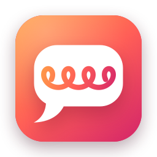
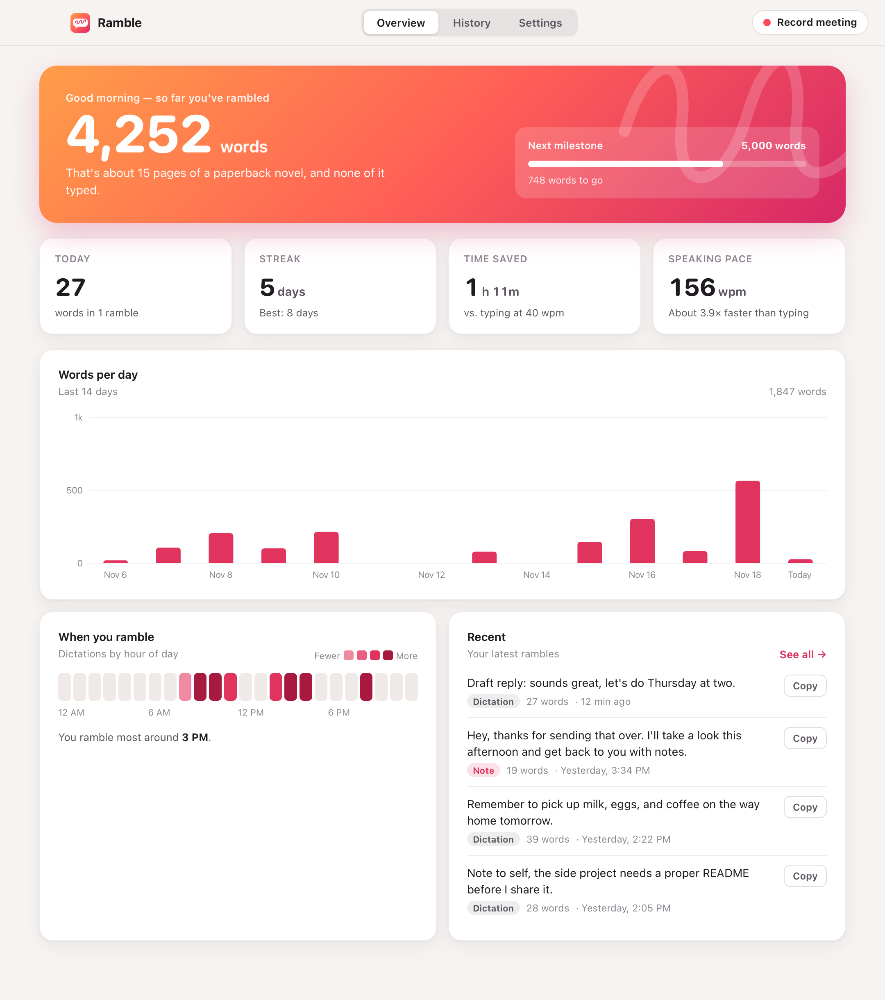
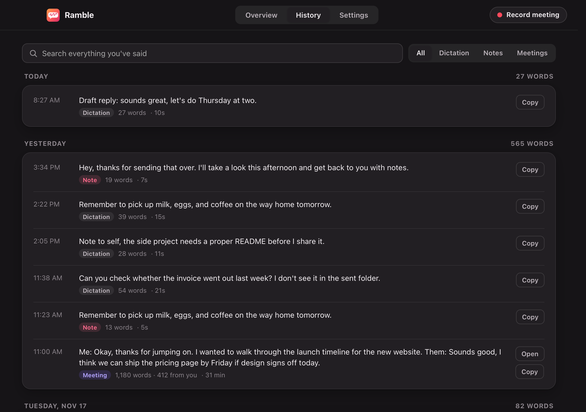
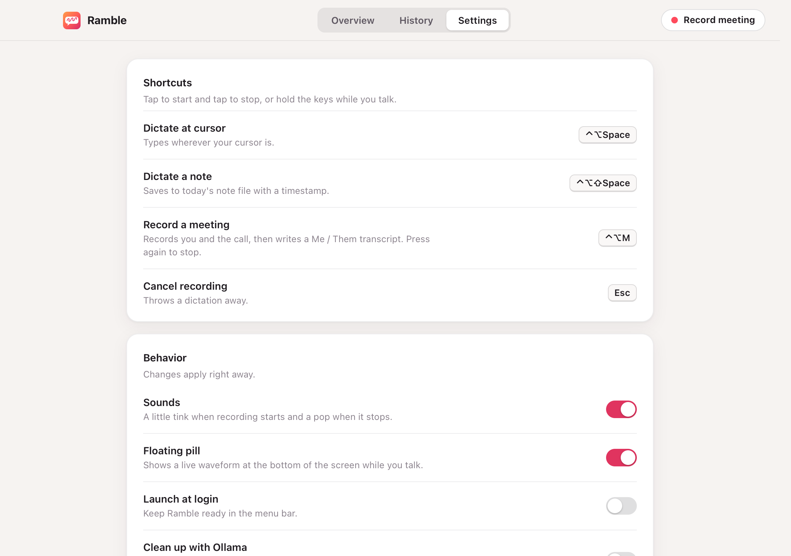

<p align="center"></p>

<h1 align="center">Ramble</h1>

<p align="center"><b>Talk, and it types.</b> A local, private dictation and meeting-notes app for the Mac menu bar.<br>
Speech-to-text runs on your Mac with <a href="https://github.com/ggml-org/whisper.cpp">whisper.cpp</a>: no account, no subscription, works offline.</p>



## Why I built it

I was paying $10 a month for a dictation app, and I only used two of its features: talking instead of typing,
and quick voice notes, mostly through AirPods. Whisper models run fast on Apple Silicon now, so I built my own
version that does exactly what I use, runs entirely on my laptop, and costs nothing. Then I added the parts I
wished the paid one had: meeting transcripts with **Me** and **Them** labels, a stats window, and a way for
Claude to read my meeting notes.

## What it does

| Hotkey | What happens |
|---|---|
| **⌃⌥Space** | Dictate. When you stop, the text is pasted wherever your cursor is. |
| **⌃⌥⇧Space** | Dictate a note. It's appended, with a timestamp, to `~/Documents/Ramble Notes/YYYY-MM-DD.md`. |
| **⌃⌥M** | Record a meeting: your mic and the call audio, transcribed into a timestamped Me / Them transcript. |
| **Esc** | Cancel a dictation. |

Tap a hotkey to start and again to stop, or hold it while you talk. A floating pill at the bottom of the
screen shows a live waveform, and the menu-bar icon turns red while recording and orange while transcribing.

- **Accurate and quick.** It uses Whisper large-v3-turbo with Metal acceleration; a short dictation is
  transcribed in one to two seconds on an M2 Pro.
- **Pauses your music** (Spotify, Apple Music, YouTube...) while you dictate and resumes it afterwards. It
  leaves it alone when another app is using the mic, like a call, or during a meeting recording.
- **A custom vocabulary** of names and jargon, passed to Whisper as a hint.
- **Searchable history and stats**: words per day, streaks, time saved versus typing, speaking pace, and the
  hours you talk most.
- **Light and dark mode.**
- **Optional cleanup** of filler words with a local [Ollama](https://ollama.com) model.

<table>
<tr>
<td></td>
<td></td>
</tr>
</table>

## Meetings

Ramble records two tracks at once: your **microphone** and the Mac's **audio output**, which carries everyone
else on Zoom, Meet, Teams, FaceTime and so on. It captures the output audio with ScreenCaptureKit, audio only.
Each track is transcribed separately, then the two are merged by time, so who said what comes from which track
it was on, with no guessing:

```markdown
**Me** · 0:00
Okay. Thanks for jumping on. I wanted to walk through the launch timeline for the new website.

**Them** · 0:06
Sounds good, I think we can ship the pricing page by Friday if design signs off today.
```

The merge step does three things:

- **Echo removal.** On speakers, your mic also picks up the other side of the call. A "Me" line is dropped when
  most of its words appear in an overlapping "Them" line.
- **Accurate start times.** Whisper tends to snap the first segment to 0:00. Ramble moves each segment's start
  to the actual speech onset, which it finds from the audio level.
- **No hallucinated lines.** Whisper sometimes "hears" stock phrases like "Thanks for watching!" in silence.
  Those are dropped when nothing else was said nearby.

The audio is deleted once the transcript is saved. Some places require everyone's consent to record a call.

## Ask Claude about your meetings (MCP)

[`mcp/ramble_mcp.py`](mcp/ramble_mcp.py) is a read-only [Model Context Protocol](https://modelcontextprotocol.io)
server. It uses only the Python standard library, so it runs on macOS's built-in `/usr/bin/python3`. It lets
Claude Code and the Claude desktop app read your transcripts, so you can ask "What did we decide in my last
meeting?" or "Find everything I said about the budget this week."

| Tool | What it does |
|---|---|
| `list_meetings` | Meetings, newest first, with length, word counts and the opening line. Can be filtered by date. |
| `read_meeting` | One full transcript, by id, by date, or `latest`. |
| `search_ramble` | Searches meetings, notes and dictations, and returns matching passages with where and when they were said. |
| `read_notes` | One day's dictated notes. |

`./mcp/install.sh` installs the server to `~/Library/Application Support/Ramble/mcp/`. It registers it with Claude
Code at user scope, including any extra `~/.claude-*` config folders, and adds it to the desktop app's
`claude_desktop_config.json`, saving a backup of that file first.

## Build it

You'll need macOS 13 or later (Apple Silicon recommended), the Xcode Command Line Tools, and `cmake`
(`brew install cmake`). Xcode itself isn't needed.

1. **Build the speech engine:**

   ```bash
   S="$HOME/Library/Application Support/Ramble"
   git clone --depth 1 --branch v1.9.5 https://github.com/ggml-org/whisper.cpp "$S/whisper.cpp"
   cmake -S "$S/whisper.cpp" -B "$S/whisper.cpp/build" -DCMAKE_BUILD_TYPE=Release \
     -DGGML_METAL=ON -DGGML_METAL_EMBED_LIBRARY=ON -DBUILD_SHARED_LIBS=OFF -DWHISPER_SDL2=OFF
   cmake --build "$S/whisper.cpp/build" -j --target whisper-cli
   ```

   A `whisper-cli` in `/opt/homebrew/bin` or `/usr/local/bin` also works.

2. **Download the model** (about 550 MB):

   ```bash
   mkdir -p "$S/models"
   curl -L -o "$S/models/ggml-large-v3-turbo-q5_0.bin" \
     https://huggingface.co/ggerganov/whisper.cpp/resolve/main/ggml-large-v3-turbo-q5_0.bin
   ```

3. **Build and install the app:** `./build.sh`. This compiles Ramble, installs it to `~/Applications/Ramble.app`,
   and launches it.

4. **Grant permissions** when macOS asks:

   - **Microphone**, to hear you.
   - **Accessibility**, to paste at the cursor. Without it, text goes to the clipboard instead.
   - **Screen & System Audio Recording**, for meetings only.

**Keep permissions across rebuilds (optional).** An app signed without a certificate gets a new identity each
time it's built, so macOS forgets its permissions. To avoid that:

1. In Keychain Access, choose **Certificate Assistant › Create a Certificate**.
2. Name it `Ramble Signing`, choose **Self Signed Root**, and set the type to **Code Signing**.

`build.sh` uses this certificate automatically when it exists.

## How it's built

- **[`Sources/main.m`](Sources/main.m)**: the entire app in one Objective-C file, built with `clang` and no
  Xcode project. It handles the Carbon global hotkeys, recording with `AVAudioRecorder`, the
  ScreenCaptureKit audio capture, pasting with `CGEvent` ⌘V, the floating `NSPanel` pills, and the meeting merge.
- **[`Resources/app.html`](Resources/app.html)**: the stats, history and settings window, shown in a `WKWebView`
  and connected to the app through a script message handler. Opened directly in a browser, it shows demo data.
- **[`tools/make_icon.m`](tools/make_icon.m)**: draws the app icon, a speech bubble with a looping squiggle
  (a prolate cycloid), at every size macOS needs.
- **[`tools/snapshot.m`](tools/snapshot.m)**: renders the window with demo data to make the screenshots in this README.
- Transcription runs `whisper-cli` as a subprocess. Meetings use its timestamped output for each track.

To test the meeting merge without a call, run
`build/Ramble.app/Contents/MacOS/Ramble --transcribe-meeting me.wav them.wav`.

I designed and built Ramble with [Claude Code](https://claude.com/claude-code) as my pair programmer. I directed
the product decisions, testing and debugging. Examples: tracking down a hotkey that was quietly taken by another
app, working out why macOS kept revoking Accessibility after rebuilds, and testing dictation over AirPods.

## Data and privacy

Everything stays on your Mac:

| What | Where |
|---|---|
| Notes | `~/Documents/Ramble Notes/` |
| Meeting transcripts | `~/Documents/Ramble Notes/Meetings/` |
| History and stats | `~/Library/Application Support/Ramble/history.jsonl` |

Nothing is uploaded. The one exception is the MCP server: when you ask Claude about your meetings, the text it
reads goes to Claude, as with anything else you share in a chat.

## License

MIT, see [LICENSE](LICENSE). whisper.cpp and the Whisper models are MIT-licensed by their authors.
